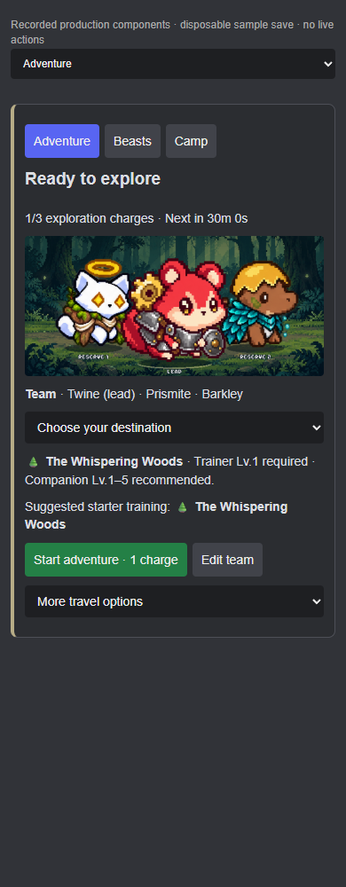
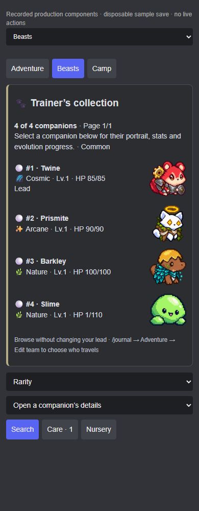
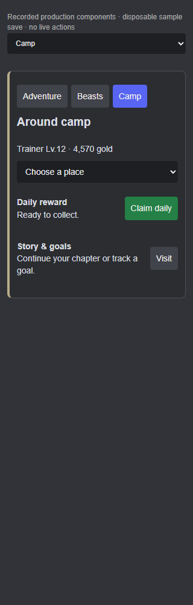

# Three-section journal

These screens use the production Discord component payloads and equipped artwork, captured with a disposable trainer. The offline browser renderer approximates Discord's layout; this is not a live Discord session. Screenshots are static. Real navigation, modals, transactions and dispatcher behavior are covered by the journal tests.

All 13 recorded screens passed width checks at 320px, 390px and 900px: no horizontal overflow, missing images or renderer errors. [Component limits](validation.json) and [viewport results](screen-checks.json) record the checks.

| Adventure · 390px | Beasts · 390px | Camp · 320px |
|---|---|---|
|  |  |  |

See the [current navigation and command guide](../FIELD-JOURNAL.md).
